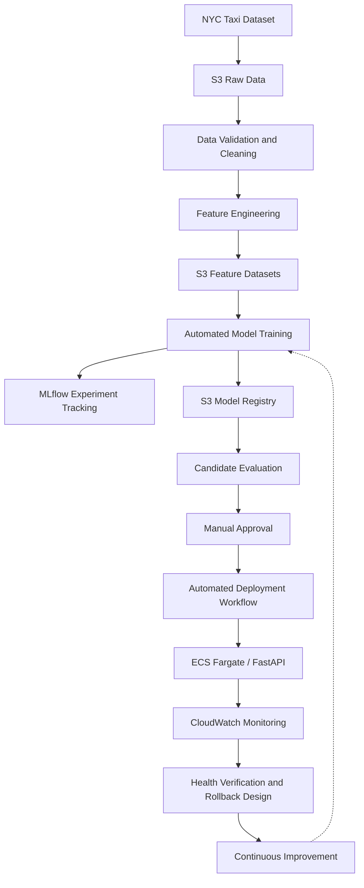

# NYC Taxi MLOps — End-to-End MLOps Platform on AWS

## Overview

NYC Taxi MLOps is an end-to-end machine learning operations project that demonstrates the design and implementation of a cloud-native ML platform using AWS, Terraform, GitHub Actions, Docker, and MLflow.

The platform uses NYC Yellow Taxi trip data to build and serve machine learning models for:

- **Fare Prediction:** Predicting taxi trip fare amounts.
- **Demand Prediction:** Estimating taxi demand using historical trip information.

The project covers the machine learning lifecycle, from data ingestion and feature engineering to model training, experiment tracking, model versioning, evaluation, approval, deployment automation, and monitoring.

## Technology Stack

| Category | Technology |
|---|---|
| Cloud Platform | AWS |
| Infrastructure as Code | Terraform |
| Programming Language | Python |
| Data Processing | Pandas, PyArrow |
| Machine Learning | LightGBM, XGBoost, Scikit-learn |
| Experiment Tracking | MLflow |
| Model Artifact Storage | Amazon S3 |
| CI/CD | GitHub Actions |
| Containerization | Docker |
| Container Registry | Amazon ECR |
| Model Serving | FastAPI |
| Container Orchestration | Amazon ECS Fargate |
| Load Balancing | AWS Application Load Balancer |
| Monitoring | Amazon CloudWatch |
| Notifications | Amazon SNS |
| Authentication | AWS IAM, GitHub OIDC |

## High-Level Architecture



## Key Features

### Data Engineering

- Ingestion of NYC Yellow Taxi trip data.
- Data cleaning and quality validation.
- Feature engineering for fare and demand prediction.
- Chronological train, validation, and test splits.
- S3-based storage for processed datasets.

### Machine Learning

- Model training using LightGBM and XGBoost.
- Model selection based on validation RMSE.
- Experiment tracking using MLflow.
- Evaluation using regression metrics.
- Model artifact versioning in Amazon S3.

### Model Lifecycle Automation

- GitHub Actions-based model retraining.
- Candidate model registration.
- Versioned model metadata and checksums.
- Candidate-versus-incumbent evaluation.
- Approval-based model promotion.
- Automated ECS deployment workflow design.
- Health verification and rollback architecture.
- Scheduled retraining as part of the continuous learning design.

### Model Serving

The prediction API is built using FastAPI and containerized using Docker.

Container images are stored in Amazon ECR, with the application hosted on Amazon ECS Fargate behind an Application Load Balancer.

| Endpoint | Description |
|---|---|
| `GET /health/ready` | Application readiness |
| `GET /models` | Loaded model information |
| `POST /predict/fare` | Predict taxi fare |
| `POST /predict/demand` | Predict taxi demand |

### Monitoring

- CloudWatch application logs and metrics.
- CloudWatch alarms.
- SNS-based alert notifications.
- Offline feature drift analysis using PSI.
- Application readiness monitoring.

## Repository Structure

```text
nyc-taxi-mlops/
├── .github/workflows/     # CI/CD and MLOps workflows
├── configs/               # Training and pipeline configurations
├── deploy/                # Deployment assets
├── docs/                  # Technical documentation
├── infrastructure/        # Terraform infrastructure
├── scripts/               # ML pipeline scripts
├── src/taxi_mlops/        # Application and ML source code
├── tests/                 # Automated tests
└── README.md
```

## Security

The platform follows AWS security best practices, including IAM role-based access, separation of workflow permissions, and GitHub Actions authentication through OIDC.

OIDC eliminates the need to store long-lived AWS access keys in GitHub Actions secrets.

## Deployment Architecture

The model serving application runs on ECS Fargate.

The model deployment workflow is designed to update the ECS task definition with an approved model artifact prefix, allowing new model versions to be deployed without rebuilding the inference application.

The broader deployment architecture includes post-deployment verification and rollback capabilities.

## Project Documentation

- [System Architecture](docs/architecture.md)
- [Model Lifecycle](docs/model-lifecycle.md)
- [Capstone Overview](docs/capstone-overview.md)

## Future Production Enhancements

- Validate automated ECS rollout and rollback in a live environment.
- Operationalize scheduled retraining.
- Add online prediction quality monitoring.
- Implement stronger model deployment safety gates.
- Expand automated integration testing.

## Conclusion

This project demonstrates the application of DevOps and cloud engineering principles to machine learning systems.

It brings together reproducible ML workflows, infrastructure automation, experiment tracking, model lifecycle management, containerized inference, and operational monitoring into a unified AWS-based MLOps architecture.