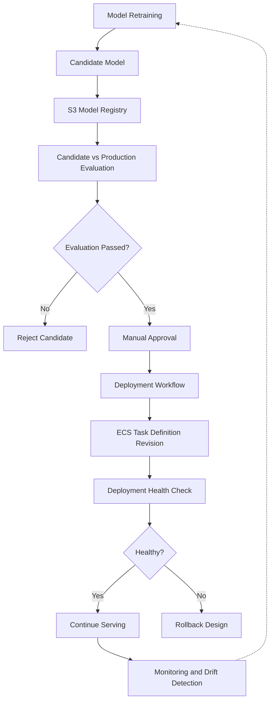

# Automated Model Lifecycle

## Overview

The NYC Taxi MLOps platform incorporates a model lifecycle that manages model training, registration, evaluation, approval, deployment automation, and monitoring.

The lifecycle is designed to make model changes traceable, reproducible, and controlled.

## Model Lifecycle Workflow



The diagram represents the complete target lifecycle. Registration, evaluation, and approval were implemented; deployment automation was prepared, while automated rollback and scheduled retraining remain to be validated or operationalized.

## Stage 1 — Automated Model Training

GitHub Actions triggers the training workflow.

The pipeline retrieves processed feature datasets from S3 and trains fare and demand prediction models.

Training artifacts include:

- Serialized model files.
- Model performance metrics.
- Training metadata.
- Experiment tracking information.

## Stage 2 — Model Registration

Trained models are registered using versioned S3 prefixes.

Example:

```text
models/
├── candidates/
│   └── <candidate-id>/
│       ├── fare/
│       │   ├── model.joblib
│       │   └── metrics.json
│       ├── demand/
│       │   ├── model.joblib
│       │   └── metrics.json
│       └── summary.json
└── registry/
    └── versions/
        └── <candidate-id>.json
```

Registry metadata includes artifact references, checksums, and candidate information.

## Stage 3 — Candidate Evaluation

A candidate model is compared against the incumbent model using the same evaluation dataset.

Performance is assessed using RMSE for both fare and demand prediction.

Evaluation results are stored in S3 to provide traceability.

## Stage 4 — Model Approval

Candidates passing the evaluation gate become eligible for manual approval.

GitHub Actions uses a protected approval environment to control authorization.

The approval workflow verifies registration and evaluation evidence before creating an approval record.

## Stage 5 — Automated Deployment

The deployment workflow is designed to deploy an approved model version to ECS Fargate.

The process includes:

1. Reading the approved model metadata.
2. Resolving the model artifact location in S3.
3. Preparing an updated ECS task definition.
4. Updating the ECS service to use the approved model version.
5. Recording deployment information.

The deployment automation was prepared, but the live production-style rollout was not executed as part of the final capstone validation.

## Stage 6 — Deployment Verification and Rollback

The extended deployment architecture includes verification of the new ECS deployment and rollback when health checks fail.

These mechanisms are part of the intended reliability design and require implementation or execution evidence before being treated as validated operational features.

## Stage 7 — Monitoring and Retraining

CloudWatch monitors the serving infrastructure, while offline drift analysis helps identify changes in feature distributions.

Scheduled retraining is included in the continuous improvement architecture so that future model versions can be generated and evaluated periodically.

## Benefits

- Automated and reproducible training.
- Traceable model versions.
- Consistent candidate evaluation.
- Controlled model approval.
- Separation of training and deployment permissions.
- Foundation for automated model rollout and recovery.
- Monitoring and drift detection capabilities.

## Conclusion

The model lifecycle demonstrates how ML model changes can be managed using CI/CD principles.

It provides a foundation for continuous training, controlled deployment, monitoring, and model improvement on AWS.